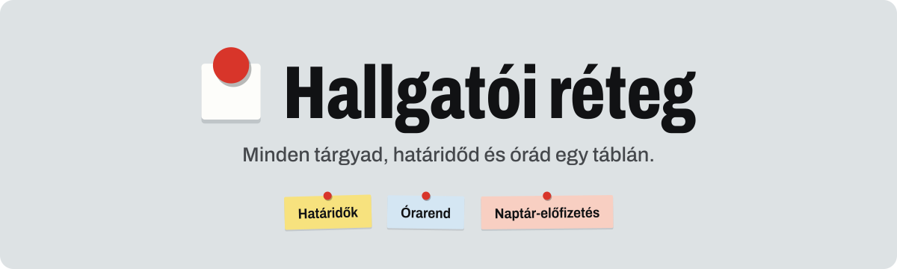

# Hallgatói réteg

<picture>
  <source media="(prefers-color-scheme: dark)" srcset="docs/brand/readme-header-dark.svg">
  
</picture>

Egy réteg az egyetemi rendszerek (Neptun, Canvas, Moodle, Teams, TMS, Discord…) fölött: minden tárgyad linkjei, anyagai és határidői egy helyen, plusz **egyetlen összefésült naptár**, amire Apple és Google Naptárból is fel tudsz iratkozni.

Élő oldal: <https://hallgatoui.vercel.app>

## Mit tud?

- **Tárgyak** – tárgyanként a platformlinkek (Neptun, Canvas, Teams…), anyagok (jegyzet, ZH, megoldás, videó) és határidők.
- **Naptár-import** – Canvas, Moodle (és bármilyen iCal) feed hozzáadása. A határidők automatikusan a megfelelő tárgyhoz kerülnek, a Canvas-kurzusokból tárgyak is létrehozhatók. Hozzáadáskor a már lejárt határidők egy pipával késznek jelölhetők.
- **Határidő-radar** – hetekre bontva, sürgősség szerint, kritikus jelöléssel és heti összesítővel.
- **Összefésült naptár-előfizetés** – egy `.ics` link, ami minden forrást és a saját határidőidet is tartalmazza:
  - a kész elemek kimaradnak, a kritikusak 🔴 jelet és emlékeztetőt (1 nap és 1 óra előtte) kapnak;
  - **nézetek**: minden / csak kritikus / ZH-k / egy tárgy (`?nezet=…`), így tárgyanként külön színnel is feliratkozhatsz;
  - hétfőnként **📋 Heti radar** összesítő, a kritikus határidők előtti két napon **📚 Készülés** blokk;
  - ha egy forrás áthelyez egy határidőt, 48 óráig **(módosult)** jelzést kap;
  - a szerver magától is frissíti a forrásfeedeket, és szól, ha valamelyik több mint 24 órája nem elérhető.
- **Órarend-import** – a Neptunból exportált `.ics` órarend (Naptár → Exportálás) a böngészőben dolgozódik fel, nem töltődik fel sehová. Egyszer hozzárendeled a tárgyakhoz az órákat, utána a heti menetrendben (halványabb, szaggatott keretű blokkokként), a tárgy oldalán és a naptár `?nezet=orarend` nézetében jelennek meg; a szünnapok külön jelölést kapnak.
- **Duplikátumok összevonása** – ha ugyanaz a határidő több forrásból (Canvas, Moodle, Neptun, kézi) is megjön, egyszer látszik, "+N forrás" jelzéssel; a "Nem duplikátum" gombbal kivételt tehetsz. Az alkalmazásban és a naptárban is, kikapcsolható.
- **Keresés és gyors felvétel** – `Ctrl K`, ékezetfüggetlen keresés.
- **Értesítések** – böngészőértesítés a közelgő határidőkről, amíg nyitva van egy lap.

## Adatvédelem

Az adataid a fiókodhoz tartoznak (e-mail + jelszó vagy belépő link, megerősített e-mail-cím), és a szerveren tárolódnak, így minden eszközön ugyanazok. A böngésző csak gyorsítótárat tart. A naptár-előfizetési link csak olvasni enged, és bármikor lecserélhető vagy kikapcsolható a Beállításokban; a fiók törlésekor minden adatod törlődik. A `.ics` letöltés szerver nélkül is működik.

## Fejlesztés

```bash
npm install
npm run dev     # http://localhost:3000
npm run lint
npm run build
npm test        # node:test, TZ=UTC, valódi iCal-fixture-ökkel (fixtures/ical)
```

Next.js (App Router), React, Tailwind CSS v4, zustand, ical.js, lucide-react. A projekt konvenciói (mappaszerkezet, design-tokenek, iCal-szabályok) a [`CLAUDE.md`](CLAUDE.md)-ben vannak.

### Felépítés

| Hely | Tartalom |
| --- | --- |
| `app/` | Oldalak (`/`, `/targy/[id]`, `/radar`, `/beallitasok`) és API-útvonalak |
| `app/api/ical` | CORS-proxy az iCal feedekhez (SSRF-védelemmel) |
| `app/api/fiok`, `app/api/adatok` | Fiókkezelés és az adatdokumentum szinkronja |
| `app/api/naptar` | A nyilvános `.ics` végpont |
| `components/` | UI; `components/ui/` az alapelemek, `components/settings/` a beállítások szekciói |
| `lib/` | Tiszta logika: store, radar, keresés, iCal-feldolgozás és -export |
| `app/tokens.css` | Design-tokenek („night blueprint” sötét téma, Fira Code) |

## Fiókok, naptár-előfizetés / deployment

A fiókok, az adatok és az összefésült naptár (`/api/naptar/<token>.ics`) szerveroldali tárolást igényelnek (Upstash Redis), a regisztrációs és belépő levelekhez pedig e-mail-küldést (lásd lent, Resend). Új környezeti változó nincs. Vercelen: Project → Storage → Upstash Redis hozzáadása. Környezeti változók (a Marketplace bármelyik párt beállíthatja):

- `UPSTASH_REDIS_REST_URL` és `UPSTASH_REDIS_REST_TOKEN`, vagy
- `KV_REST_API_URL` és `KV_REST_API_TOKEN`.

Fejlesztésben (`npm run dev`) nincs szükség rájuk: memóriabeli tároló működik. Éles környezetben, ha hiányoznak, a végpontok 503-at adnak.

### E-mail-összefoglaló

A fiókhoz tartozik (Beállítások → Értesítések): napi, heti (hétfő) vagy havi (1-je) levél a fiók e-mail-címére a közelgő és lejárt határidőkről, leiratkozó linkkel (külön megerősítés nincs, a fiók címe már megerősített). A napi levél csak akkor megy ki, ha aznap vagy másnap van határidő, és a napi órarendet is mutatja. A küldést a `vercel.json` napi cronja indítja (`/api/cron/hirlevel`, 04:00 UTC). Környezeti változók:

- `RESEND_API_KEY`: [Resend](https://resend.com) API-kulcs;
- `DIGEST_FROM`: feladó egy Resendben ellenőrzött domainről, pl. `Hallgatói réteg <hirlevel@example.hu>`;
- `CRON_SECRET`: a Vercel ezt küldi a cronnal (`Authorization: Bearer …`), élesben kötelező;
- `APP_URL` (nem kötelező): a levelek linkjeinek címe; alapból `VERCEL_PROJECT_PRODUCTION_URL`.

Fejlesztésben kulcs nélkül a levelek a szerver naplójába kerülnek, a cron pedig kézzel hívható: `curl localhost:3000/api/cron/hirlevel`.
